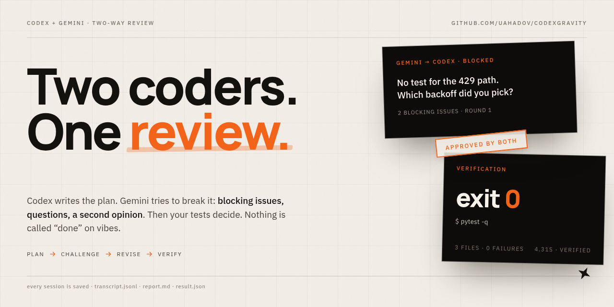
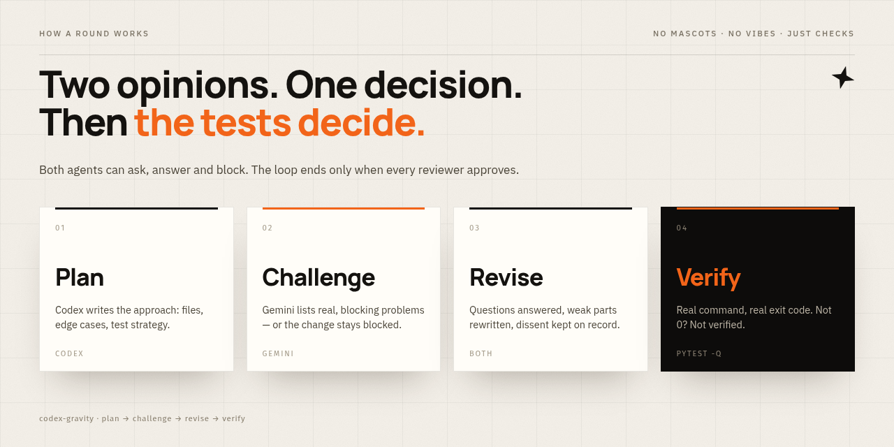
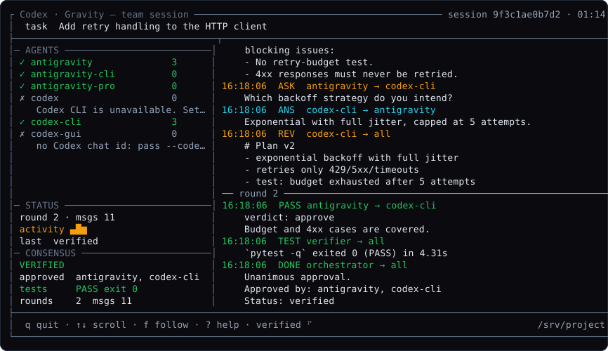

# Codex-Gravity



**Two AI coders that check each other's work — before you merge.**

One writes the plan. The other tries to break it. They ask each other questions, fix what
is weak, and only then run your tests. You can read the whole conversation afterwards.

[](.github/workflows/tests.yml)
[](pyproject.toml)
[](LICENSE)
[](docs/TEAMWORK.md)
[](pyproject.toml)

## What is this?

A single AI assistant will happily tell you "done" even when the code is broken —
because nobody is checking.

Codex-Gravity gives it a teammate with a different opinion. Codex proposes; Gemini
reviews like a strict senior engineer — *"no test for the timeout case, and which backoff
did you pick?"* The author answers, revises, and the reviewer approves… or the change
stays blocked. Then a real command (`pytest`, `npm test`, your CI script) decides whether
it actually works.

No dashboard to host, no database, no account: one MCP server, one CLI, and a transcript
file for every session.

## How it works



1. **Plan** — Codex writes a concrete plan: files, edge cases, test strategy.
2. **Challenge** — Gemini reviews it and lists real, blocking problems.
3. **Answer & revise** — questions are answered and the weak parts are rewritten.
4. **Verify** — only after agreement, the real test command runs. `exit 0`, or it is not verified.

## See it



That is a live terminal dashboard (nothing extra to install): who is available, what they
are saying right now, the round counter and the final verdict with the test result.

## Try it in 30 seconds

No API keys, no accounts — the demo agents are scripted, everything else is real:

```bash
git clone https://github.com/uahadov/codexgravity.git
cd codexgravity
python3 -m venv .venv && source .venv/bin/activate   # fish: source .venv/bin/activate.fish
pip install -e .
python examples/scripted_demo.py
```

Press `q` to leave the dashboard.

## Why two models?

- A model that checks itself agrees with itself. A *different* model does not.
- "Looks good" is not a review. Here a review is a verdict with blocking issues — or it is not an approval.
- Talking is cheap, tests are not. The team only claims success when the command exits `0`.

---

**Below is the technical reference**: install options, the pull-request review gate, MCP
tools, transports and the exact guarantees.

## Features

- **Symmetric roles** — any agent can be `planner`, `implementer`, `reviewer`, `critic`
  (with veto) or `judge`. Swap them per run.
- **Adversarial review loop** with configurable rounds, unanimity or weighted majority.
- **Cross-examination** with correlation-linked `question → answer` threads.
- **Interjection mid-run** — a human or another agent can push a `note` into a live
  session; it is drained at the next round and shown to every agent.
- **Dissent is kept** — approvals, objections, blocking issues and unavailable agents are
  all recorded in the result and the report.
- **Real verification** — `--test-cmd "pytest -q"`; failure triggers a repair attempt,
  then an honest `failed` status.
- **Persistent sessions** — `--session-id`, resume-friendly status/transcript tools.
- **Cancellation** — stop at the next round boundary without killing in-flight turns.
- **EventBus mirroring** — every team message also appears on the Studio dashboard.
- **MCP native** — six `team_*` tools; works from Codex, Claude Desktop or any MCP client.
- **Offline-testable** — the engine is agent-agnostic; the suite runs with scripted agents.

## Compared to naive chaining

| Problem with naive chaining | What this harness does |
| --- | --- |
| A model says "looks good" and nobody checks | Reviewers must emit `{verdict, blocking_issues, questions}`; approval with blockers is demoted to `revise` |
| Reviewers can't interrogate the author | **Cross-examination**: reviewer questions → implementer answers → answers become revision context |
| "Consensus" is whatever the last model said | Weighted/unanimous tally, veto agents, recorded dissent, optional judge, explicit deadlock |
| Nobody runs the tests | Post-consensus verification with real exit codes and a bounded repair budget |
| You can't audit what happened | Append-only JSONL transcript + `report.md` + `result.json`, private permissions |
| Agents lie when a transport is down | Every adapter returns `ok=False` with a reason; sessions report `unavailable`, never a fake answer |

## Quickstart

```bash
python3 -m venv .venv && source .venv/bin/activate   # fish: source .venv/bin/activate.fish
pip install -e ".[dev]"        # .[media] adds the live Gemini SDK

# See the TUI immediately — scripted agents, no model or API key needed:
python examples/scripted_demo.py

# 1. What can actually talk right now?
codex-gravity-team --check

# 2. Run a real debate + verification
codex-gravity-team "Harden the upload endpoint" -w /abs/path/to/project \
  --review-with codex,antigravity --rounds 3 --test-cmd "pytest -q"
```

### Choose the roles

```bash
# No CLI needed: use the ChatGPT/Codex desktop app as the Codex teammate.
# --codex-thread switches the default Codex roles to "codex-gui".
codex-gravity-team "Harden the upload endpoint" -w /abs/project \
  --codex-thread 01a168f9-d943-7a50-be88-2b7a7579a3c9 --test-cmd "pytest -q"

# Codex proposes, Antigravity implements, both review, Codex judges a deadlock
codex-gravity-team "Design the migration" -w . \
  --plan-with codex --implement-with antigravity \
  --review-with codex,antigravity --judge codex

# Security critic with veto + weighted votes
codex-gravity-team "Rotate the signing keys" -w . \
  --review-with codex,antigravity --veto antigravity --weight codex=2

# Reverse direction: Antigravity proposes, Codex reviews and pushes back
codex-gravity-team "Choose the caching strategy" -w . \
  --plan-with antigravity --implement-with antigravity --review-with codex

# Majority instead of unanimity, plus a human constraint for every round
codex-gravity-team "Refactor the router" -w . --majority \
  --note "No new runtime dependencies."
```

### Register the MCP server

```json
{
  "mcpServers": {
    "codex-gravity": {
      "command": "/abs/path/codex-gravity/.venv/bin/codex-gravity-mcp",
      "args": ["--transport", "stdio"]
    }
  }
}
```

Then, from your MCP client:

```json
{"prompt": "Add idempotency keys to the payment API",
 "workspace_path": "/abs/path/project",
 "review_with": "codex,antigravity",
 "test_command": "pytest -q",
 "human_notes": "Keep the public API stable."}
```

Tool: **`team_run_task`**. It returns the full result, and the session stays on disk for
`team_status`, `team_transcript`, `team_send_message` and `team_cancel`.

## Review a pull request (two agents, one gate)

`codex-gravity-review` reviews **your actual diff** — no plan, no sandbox copy:

```bash
codex-gravity-review --base origin/main --auto-test      # what a PR would change
codex-gravity-review --staged                            # the index, before commit
codex-gravity-review --base HEAD~1 --test-cmd "pytest -q"
```

It exits `0` only when **every** reviewer approved and the verification command (if any)
passed; `1` when the change is blocked or the build failed; `2` when no reviewer was
reachable or the diff was empty. Artefacts: `.codex-gravity/team/<session>/review.md` and
`transcript.jsonl`.

In CI the bundled Action posts one **sticky comment** per pull request (updated on every
push) with both verdicts, blocking issues, dissent and the test result:

```yaml
- uses: actions/checkout@v4
  with: { fetch-depth: 0 }
- uses: uahadov/codexgravity@v1
  with:
    base: origin/${{ github.base_ref }}
    gemini-api-key: ${{ secrets.GEMINI_API_KEY }}
    reviewers: antigravity,antigravity-pro   # two different Gemini models
    test-command: pytest -q
```

Setup, inputs and cost notes: **[docs/CI.md](docs/CI.md)**.

## Inside a round

```
              ┌──────────────────────── Codex-Gravity ────────────────────────┐
              │                                                              │
  task ──────▶│  planner ──proposal──▶ reviewers (codex / antigravity / …)    │
              │     ▲                        │                               │
              │     │                    verdict + blockers + questions     │
              │     │                        ▼                               │
              │     └──revision◀── implementer ◀──cross-examination──┐       │
              │                              │                      │       │
              │                              └──── answer ──────────┘       │
              │                                                              │
              │  tally (unanimous | weighted | veto) ──▶ judge on deadlock   │
              │                              │                               │
              │                              ▼                               │
              │             real verification command ──▶ repair budget      │
              └──────────────────────────────┬───────────────────────────────┘
                                             ▼
                    transcript.jsonl · report.md · result.json · EventBus
```

Every step writes a typed message (`proposal`, `critique`, `question`, `answer`,
`revision`, `approval`, `rejection`, `verification`, `consensus`, `escalation`) with
sender, recipient, round and correlation id. Details:
**[docs/TEAMWORK.md](docs/TEAMWORK.md)**.

## Dashboard details (keys, replay, fallback)

On a terminal the run opens a **btop-style dashboard** (curses, no dependencies) that
redraws 10×/s: agent panel with reachability, live transcript with badges, round
separators, a message sparkline, the consensus panel and real verification results.
There is also a recorded walkthrough: `asciinema play docs/demo.cast`.

```text
┌ Codex · Gravity — team session ────────────── session 9f3c1ae0b7d2 · 01:14 ┐
│  task  Add retry handling to the HTTP client                              │
├─ AGENTS ────────────────────┬─ TRANSCRIPT ───────────────────────────────┤
│ ✓ antigravity          3    │ 15:37:09  CRIT antigravity → codex-cli     │
│ ✓ antigravity-cli      0    │     verdict: revise                        │
│ ✗ codex                0    │     blocking: no retry-budget test         │
│    Codex CLI is unavailable │ 15:37:09  ASK  antigravity → codex-cli     │
│ ✗ codex-gui            0    │     Which backoff strategy?                │
│    no Codex chat id: pass…  │ 15:37:09  ANS  codex-cli → antigravity      │
│                             │     Exponential with full jitter.          │
│─ STATUS ────────────────────│ 15:37:09  REV  codex-cli → all             │
│ round 2 · msgs 11           │     # Plan v2                              │
│ activity ▄█▆                │ ── round 2 ─────────────────────────────── │
│ last  verified              │ 15:37:09  PASS antigravity → codex-cli     │
│─ CONSENSUS ─────────────────│ 15:37:09  TEST verifier → all              │
│ VERIFIED                    │     `pytest -q` exited 0 (PASS) in 4.31s   │
│ approved  antigravity, codex│ 15:37:09  DONE orchestrator → all          │
│ tests     PASS exit 0       │     Unanimous approval. Status: verified   │
├─────────────────────────────┴────────────────────────────────────────────┤
│  q quit · ↑↓ scroll · f follow · ? help · verified ⠋   /srv/project       │
└──────────────────────────────────────────────────────────────────────────┘
```

Keys: `q`/`Esc` quit · `↑`/`↓`/`PgUp`/`PgDn` scroll · `Home`/`End` jump · `f` follow ·
`r` reset · `?` help. Piped output (CI, `docker logs`) automatically switches to plain
lines; `--ui ansi` keeps colours, `--ui plain` forces text, `--ui gui` forces the
dashboard. Terminals smaller than 76×18 show an explicit hint instead.

Replay or follow any session later (works from a server, no team process needed):

```bash
codex-gravity-tui --workspace /srv/project                      # latest session
codex-gravity-tui -w /srv/project --session 9f3c1ae0b7d2        # a specific one
codex-gravity-tui -w /srv/project --follow                      # tail until DONE/ESC
```

No model yet? `python examples/scripted_demo.py` runs the whole thing with scripted
agents so you can try the dashboard immediately.

Badges: `PLAN` `CRIT` `ASK` `ANS` `REV` `PASS` `FAIL` `TEST` `DONE` `ESC` `NOTE`.

## MCP tools

| Tool | Purpose |
| --- | --- |
| `team_agents` | Which transports are reachable right now (no fake capability). |
| `team_run_task` | Full team lifecycle with consensus + optional verification (`codex_thread` switches Codex to the desktop app). |
| `team_status` | Running/finished, last message, decision, transcript path. |
| `team_transcript` | JSON messages or rendered Markdown. |
| `team_send_message` | Human/agent message into a session (live or stored for audit). |
| `team_cancel` | Stop at the next round boundary. |
| `codex_gui_status` | Desktop app catalogue + chat state (busy, turns, last message), read-only. |
| `codex_gui_ask` | One message to an exact desktop chat, waits for the new reply, `unconfirmed` instead of guessing. |
| `antigravity_gui_status` / `_start_task` / `_task_status` / `_followup` | Drive the real Antigravity desktop conversation, scoped to a workspace. |
| `codex_gravity_watch_completion` / `_completion_status` / `_cancel_completion` | Notify an exact Codex desktop chat when a GUI task round finishes. |
| `antigravity_inspect_media` | ffprobe metadata; `status: partial` unless a model actually analyses it. |
| `antigravity_distill_context` | Distil logs/repos to a small, anchored excerpt. |
| `antigravity_verify_and_screenshot` / `call_antigravity_verifier` | Run a command, parse the failure, report viewport measurement state. |
| `call_codex_architect` | Bounded, read-only, signed-in Codex CLI answer. |
| `call_antigravity_multimodal` | Ask Antigravity/Gemini; `status: unavailable` when no transport exists. |

## Guarantees (and what is deliberately not claimed)

- **Fail-closed consensus.** No structured approval → no consensus. Unparsable review →
  `revise`. Reviewer down → `unavailable`, and a session with no available reviewer can
  never reach consensus.
- **Fail-closed verification.** `SmartRouter` runs report `success` only when a real
  `test_command`/`ui_url` returned; `verified=false` runs never merge.
- **No invented model output.** With no Codex CLI, no `agentapi`, no `GEMINI_API_KEY`
  and no reachable GUI, agents return an error and the session reports `unavailable`.
- **Viewport checks are marked `measured: false`** unless you inject a real browser
  checker; no screenshots are pretended.
- **Token/cost figures are estimates** from character counts and fixed price constants,
  never provider usage metadata.
- **Heuristic code repair is opt-in** (`allow_heuristic_repair`): flipping operators to
  make a test pass is never presented as a verified fix.

## Transports

| Agent | Needs | Notes |
| --- | --- | --- |
| `codex-cli` | the `codex` executable (`CODEX_GRAVITY_CODEX_BIN` or PATH) | **headless servers/CI**: ephemeral, read-only CLI turn, child MCP disabled |
| `codex` | same as `codex-cli` | alias, kept for readable configs |
| `antigravity-cli` | `agentapi`/`agy` (`CODEX_GRAVITY_ANTIGRAVITY_CLI_BIN`) or a command template | **headless servers/CI**: CLI only, no SDK fallback |
| `antigravity` | agentapi **or** `GEMINI_API_KEY`/`GOOGLE_API_KEY` | best-effort: local CLI first, then the GenAI SDK |
| `antigravity-pro` | same as `antigravity`, different model | second opinion for CI (default `gemini-2.5-pro`) |
| `codex-gui` | **ChatGPT/Codex desktop app** (no CLI) | one message into an exact chat UUID, waits for the *new* completed reply; refuses busy chats; never resends |
| `antigravity-gui` | Antigravity desktop with a loopback DevTools port | opt-in (`--gui`): drives a real visible conversation, refuses a different model/busy chat |

For servers and CI, the `*-cli` transports take explicit binaries and need no desktop:

```bash
export CODEX_GRAVITY_CODEX_BIN=/usr/local/bin/codex
export CODEX_GRAVITY_ANTIGRAVITY_CLI_BIN=/opt/antigravity/bin/agentapi
# distributions with different flags can wrap them:
# export CODEX_GRAVITY_ANTIGRAVITY_CLI_CMD='agy ask --model flash {prompt}'
codex-gravity-team "Harden the upload endpoint" -w /srv/project \
  --plan-with codex-cli --review-with antigravity-cli --test-cmd "pytest -q" --ui plain
```

The `codex-gui` transport talks to the app through its own `codex-app-tools` catalogue,
which it **discovers at runtime** (tool names are provided by the app, not hardcoded). It
requires `CODEX_APP_TOOLS_PIPE_PATH`, which the desktop app injects — so run this MCP
server **from the ChatGPT/Codex app**, not from a bare terminal. With no thread-read tool
in the catalogue it refuses to send, because the reply could not be verified.
Use a **dedicated chat** for the teammate (not the conversation that orchestrates the team),
otherwise the team's messages land in the orchestrator's own turn.

The desktop GUI bridge only talks to **loopback** DevTools, never restarts the app, never
changes permission presets, and fails closed when a selector is missing. Completion
notifications use the installed `codex-app-tools` MCP server, require the exact destination
chat UUID, and treat `notified` as *delivery accepted*, not review success.

## Verification & safety of the HTTP surface

The dashboard at `/` shows the live team dialogue, code, and estimated savings. Routes that
execute commands (`/api/execute-tool`, `/api/studio/run`, `/api/studio/inject`) require the
`X-Codex-Gravity-Token` header, which is inlined into the same-origin dashboard only; set
`CODEX_GRAVITY_STUDIO_TOKEN` for scripts and `CODEX_GRAVITY_STUDIO_TOOLS` to allowlist tools.
`/`, `/health` and `/api/studio/state` stay read-only on loopback.

## Development

```bash
pip install -e ".[dev]"
ruff check codex_gravity tests
pytest -q            # 247 tests, no network, no API keys
```

CI runs lint + tests on Python 3.10 and 3.12. Contributions welcome — see
[CONTRIBUTING.md](CONTRIBUTING.md).

## Docs

- [docs/TEAMWORK.md](docs/TEAMWORK.md) — protocol, consensus math, transcripts, extending agents
- [docs/CI.md](docs/CI.md) — two-agent review in CI, Action inputs, credentials, cost
- README sections below cover the desktop GUI bridge and the legacy router pipeline

## Desktop helpers (details)

### Antigravity GUI bridge

`antigravity_gui_*` speaks to the real desktop GUI: it checks the visible model selection,
refuses a busy chat or unsent draft, verifies the project, and confirms the submitted marker
before reporting `submitted`. `ready_for_review` means the GUI turn ended — not that the
implementation is correct. Polling never runs tests or approves permission prompts. Task
records live in `<workspace>/.codex-gravity/gui-tasks/` (private permissions).

### Completion handoff

Pass `notify_codex_thread_id` to a GUI call to authorize one follow-up for that round in
that exact Codex chat. Watches live in `.codex-gravity/completion-watches/`, are
file-locked against double delivery, survive an MCP restart, and turn into
`delivery_unconfirmed` (never silently resent) if an acknowledgement is lost. Expiry and
silence never mean success or consent.

## Legacy pipeline (`codex-gravity`, `SmartRouter`)

The pre-team engine (speculative drafting, shadow git worktrees, router modes
`adaptive|eco|power`) is still available:

```bash
codex-gravity "Add a healthcheck endpoint" -f src/health.py -m eco -t "pytest -q"
```

`Eco` uses the fast drafter only, `Power` adds an adversarial audit, and health checks
now fail closed: success requires a real verification result.

## License

MIT — see [LICENSE](LICENSE).
